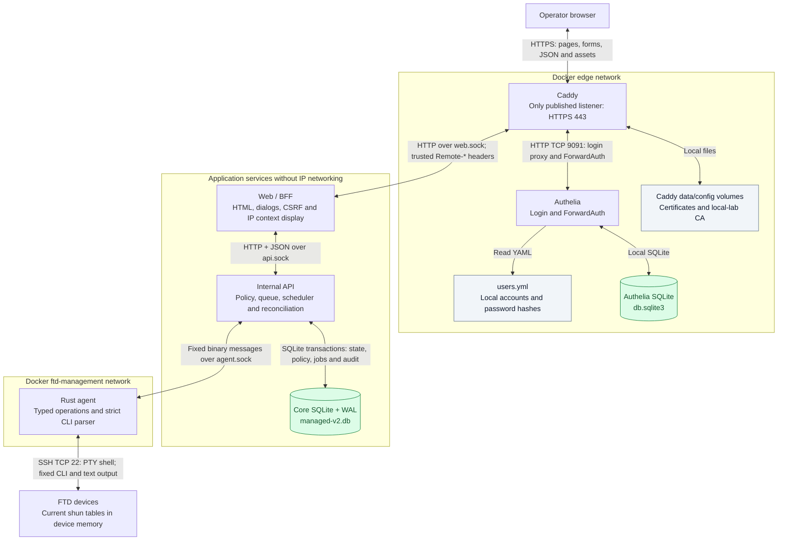
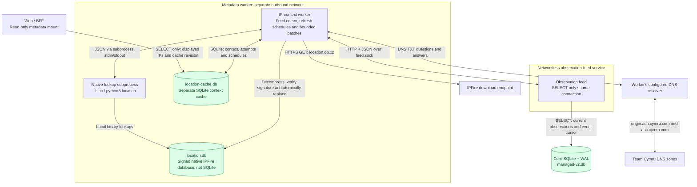

# System Architecture and Data Formats

Architecture map as of **2026-11-13**, for the operator's desk laboratory.
The main stack selects verified **v6 grouped-addition sessions**, API/feed0.13.0,
Web0.13.1 and metadata worker0.11.0. Source0.12.0 additionally contains an optional
persistent pending-session journal for experimental deferred v7; that is shown
separately below and is not enabled on the main stack.

This is a map of implemented components and their data paths. The
[Architecture and Security Design](../architecture-and-security-design.md)
defines the security contracts; [Project Status](../project-status.md) records
the deployment and acceptance evidence. Product versions and agent protocol
versions are different identifiers.

## 1. Browser, authentication and device operations

Arrows identify requests/access; responses return on the same connection.
Database arrows are SQL access, not replication between services.



The API includes the scheduler and workers in its own process. Queue jobs,
per-device leases, import membership, managed policy and audit are tables in the
**same core SQLite database**. A browser action records an attributed request;
the scheduler performs the device work and records its outcome. Queue acceptance
is distinct from verified device success.

Caddy removes client-supplied `Remote-User`, `Remote-Groups`, `Remote-Name` and
`Remote-Email` before ForwardAuth, then copies authenticated values from Authelia.
Web derives the actor from those trusted headers. API mutations carry that actor
in their JSON body, with idempotency and reviewed-scope fields where applicable.
Authelia does not access the shun database or device credentials.

Each device has a serialized command stream; different devices can progress
within the configured concurrency limit. The agent keeps one SSH connection for
a bounded visit and can perform several operations before closing it. Commands
are generated inside the agent, including `show shun`, `show shun <IPv4>`,
`shun <IPv4>` and `no shun <IPv4> interface <allowed-name>`. It waits for the
validated FTD prompt instead of using a fixed startup sleep. Cisco console output
is parsed locally into typed results.

Only Caddy publishes a host port. Docker network attachment describes reachability;
it is not itself an `FTD_IP:22` destination egress firewall. The agent owns the
FTD credential mounts. Web and API have neither those password files nor a device
network connection.

## 2. Background IP information

The metadata path is separate from device execution. IPFire supplies a signed
downloaded dataset for local lookups. The enabled Team Cymru supplement uses
DNS for public IPs whose primary context lacks ASN/network information.



The feed opens the core DB with `query_only=ON`. Its source volume is writable
only to permit SQLite WAL/SHM bookkeeping; it performs no source DML/DDL or
initialization. The internet-connected worker receives the dedicated feed socket
and its metadata volume, with no core DB, API/agent socket or FTD password mount.

There is no background database-to-database replication. The worker consumes a
bounded observation/event feed, deduplicates IPs across devices and maintains its
own advisory cache. Opening a list, search or dialog reads that cache and does
not start provider work. Metadata never supplies managed policy or execution
authority. See [Cached IP Information](ip-context.md) for refresh limits,
attribution and failure behavior.

## 3. Connections and payload formats

`UDS` means a filesystem Unix-domain socket. Internal HTTP sockets use stream
connections; the API/agent socket uses `SOCK_SEQPACKET`, which preserves message
boundaries. None of these Unix sockets is a published TCP endpoint.

| Caller and destination | Transport / address | What crosses the connection |
| --- | --- | --- |
| Browser → Caddy | HTTPS TCP443; application and authentication hostnames | UTF-8 HTML, CSS/JS, URL-encoded or multipart forms, cookies and JSON status/action replies. Live updates also fetch HTML and replace selected page regions. |
| Caddy → Authelia | HTTP on `authelia:9091`, edge network | Proxied login traffic and ForwardAuth requests describing the original request; authorization response and trusted `Remote-*` identity headers. |
| Caddy → Web | HTTP over `/run/ftd-shun-manager/web.sock` | Browser routes, form bodies, cookies and trusted identity headers; HTML, JSON or static-file responses. |
| Web → API | HTTP + JSON over `/run/ftd-shun-manager-api/api.sock` | Device IDs, dotted IPv4 strings, policy revisions, actor objects, import data, reviewed scopes and request IDs. Responses contain observations, history, pages, receipts and queue/status objects. Mutations use `Idempotency-Key` where the endpoint requires it. |
| API → agent | Fixed binary `AF_UNIX/SOCK_SEQPACKET` at `/run/ftd-shun-manager-agent/agent.sock`; peer UID checked | Typed operation, protocol version, device ID, sequence, packed IPv4 and tracked session ID as applicable. Replies contain typed outcomes, complete snapshot frames and settlement evidence. No arbitrary CLI field. |
| Agent → FTD | SSH TCP22, pinned server host key, interactive PTY shell | Agent-generated CLI lines and Cisco textual output/prompts. Password authentication reads the agent-only secret file; it is not part of an API/agent message. |
| Worker → observation feed | HTTP GET over `/run/ip-context/feed.sock` | `/observations?rowid=…&event_id=…&source=…`; JSON full baseline or bounded event delta, with a cursor. |
| Worker → native lookup subprocess | Local process stdin/stdout, UTF-8 JSON | Input: dataset path and a bounded array of dotted IPs. Output: dataset creation time and an IP-keyed result map. |
| Worker → IPFire | HTTPS GET to the fixed dataset URL | XZ-compressed signed native dataset. Lookups then happen locally; no shun list is uploaded to IPFire. |
| Worker → DNS resolver / Cymru | DNS TXT through the configured resolver | Reversed IPv4 origin questions and numeric ASN-name questions; pipe-separated TXT answers. This supplement does not use a WHOIS TCP43 session. |
| Processes → container logs | stdout/stderr, Docker logging | Application/agent structured events are JSON lines; Caddy/Authelia retain their configured logging formats. Audit events are also retained in the core SQLite store. An external log collector is a deployment integration, not another current database. |

### Examples at the boundaries

An IPv4 address has different representations at different boundaries:

```text
Browser/API JSON:           "198.51.100.250"
SQLite IP column:          four-byte BLOB, hex C6 33 64 FA
Agent binary target:       the same four packed octets, not ASCII text
Agent-generated Cisco CLI: shun 198.51.100.250
```

Examples of the current tracked binary protocol (hexadecimal opcodes; all
multi-byte integers unsigned big-endian):

```text
BEGIN_TRACKED request:
  18 version:u8 device_id:u16 session_id:16-bytes             (20 bytes)

STAGE_ADD request:
  1A version:u8 sequence:u8 IPv4:4-bytes                       (7 bytes)

Pending ADD acknowledgement:
  05 version:u8 1A sequence:u8                                (4 bytes)

Snapshot entry data:
  IPv4:4-bytes interface_length:u8 interface:ASCII

Snapshot stream:
  manifest(count/bytes/chunks) → indexed data chunks → SHA-256 end frame
```

The pending acknowledgement alone is not verified creation. Current v6 uses
complete in-session reads to verify groups. Snapshot data chunks are32KiB,
with the final chunk allowed to be shorter; the whole stream is validated before
reconciliation. For full frame layouts and bounds, see
[Large Snapshots](large-snapshots.md), [Grouped Additions](batch-additions.md)
and [Multi-group Sessions](multi-group-sessions.md).

Example feed baseline (illustrative values; this is JSON, not SQL replication):

```json
{
  "source": "0123456789abcdef",
  "baseline": true,
  "cursor": [123, "00000000-0000-4000-8000-000000000001"],
  "observations": [[1, "198.51.100.250", "management"]],
  "events": []
}
```

Later responses use `baseline: false`, an empty `observations` array and event
objects containing row ID, event ID/type, device ID, IP, interface and timestamp.
The source identity and cursor let the feed detect a changed source or a lost
event anchor and return a fresh baseline.

Only events that change observed IP presence advance this cursor. Routine lease
coordination does not enter the feed. Successfully settled empty v6 visits can
reclaim their own temporary claim without invalidating the metadata cursor or
triggering another full baseline/provider attempt.

## 4. Databases, files and ownership

Paths below are **container paths**. Named volumes give different services
different paths to the same underlying files; this does not create extra copies.

| Store | Format and contents | Owner / access |
| --- | --- | --- |
| Core DB: `/var/lib/ftd-shun-manager/managed-v2.db`, volume `state` | SQLite in WAL mode. Public device identity, observed shuns, history/audit, Protected IPs, import preparations/membership, current managed rules, queue/results, leases, controls and recovery evidence. | API owns application writes. Feed sees the same file as `/observations/managed-v2.db` through a query-only SQL connection. Web/metadata worker/agent do not mount this core volume in the current composition. |
| Core `managed-v2.db-wal` / `managed-v2.db-shm` | SQLite transaction and shared-memory companion files. These belong to the core DB, not separate application databases. | SQLite manages them; backup must respect SQLite consistency. |
| `/ip-context/location-cache.db`, volume `ip-context-cache` | Separate SQLite, rollback-journal mode. Observed-IP keys/cursor, normalized IPFire JSON payloads, lookup attempts/refresh deadlines and the `cymru_entries` supplement with its own source/time. | Metadata worker writes; Web reads on a strictly read-only mount. API/agent have no mount. |
| `/ip-context/location.db`, same metadata volume | Signed native libloc binary database of country/prefix/ASN/operator mappings. **Not SQLite.** | Worker downloads/verifies/replaces; its native subprocess reads. Web does not query the dataset directly. |
| `/var/lib/authelia/db.sqlite3`, volume `authelia-data` | Authelia's own SQLite persistent authentication storage, separate from shun observations/policy. | Authelia only. Local account password hashes are configured separately in `users.yml`. |
| `/config/users.yml` in Authelia | Read-only YAML local users, password hashes and groups. | Host-provisioned file mounted into Authelia. LDAP(S) is an alternative authentication-backend configuration, not an additional current DB or running service. |
| `devices.json` → `/etc/ftd-shun-manager/devices.json` | Read-only JSON public inventory: stable numeric ID, hostname, management IPv4, pinned SSH host key, interface allowlist, enabled state and optional supported ADD profile. | Host-provisioned file read by API and agent. Device identity is keyed by ID, not by its current management IP. |
| `/run/secrets/ftd_ssh_password` in the base shared-credential profile | Secret file containing the SSH password; separate from public inventory and all application DBs. | Agent-only mount. Optional per-device mode uses an agent-only JSON ID/login/secret-name mapping and separate password files. |
| Caddy `/data` and `/config` | Persistent Caddy/TLS state. The local-lab profile uses its internal CA. | Caddy only; not a policy, queue or IP-information DB. |
| Web reviews and agent session journal in main v6 | Bounded process memory. Short-lived Web review tokens/scopes and agent completion keys/receipts are not a shared database. | Owned by the corresponding process. Durable import preparations and accepted requests live in the core DB. |

Within the core DB these are logical groups, not separate databases:

| Logical group | Representative tables | Stored relationship |
| --- | --- | --- |
| Observations and history | `devices`, `shun_state`, `shun_events`, `shun_import_origins` | Device/IP/interface occurrences and timestamps, audit actor/request identity and proved creation provenance where available. |
| Import preparation and membership | `import_preparation_plans`, `import_preparation_targets`, `managed_bulk_manifests`, `managed_bulk_members` | Reviewed source/classification and import membership; historical membership alone does not grant current ownership. |
| Current policy and protection | `managed_shun_targets`, `managed_shun_requests`, `protected_ips`, `protected_policy` | Current device/IP maintenance authority and fleet-wide automatic-unblock policy. |
| Queue, attempts and scheduling | `operation_requests`, `operation_jobs`, `operation_links`, `managed_bulk_attempts`, `managed_bulk_device_executors`, `managed_bulk_controls` | Attributed requests, individual jobs/results, original evidence, per-device fences and independent import/restoration pauses. |

Import preparation reports are short-lived: up to four active reviews per owner
and sixteen overall. A new save and daily maintenance reclaim expired, cancelled
or confirmed reports; accepted manifests/membership, policy, jobs and receipts
remain independent. Successful empty visits do not retain redundant lease audit
pairs. Operator history omits coordination/intermediate bookkeeping, while
failure, mutation and recovery evidence remains retained. See
[Operator Workspace](operator-workspace.md#useful-history-and-quiet-device-checks).

IPv4 keys in core/cache tables are four-byte BLOBs. Many descriptors, actor-role
lists and event/provider details are JSON stored in TEXT columns. IDs and audit
timestamps are normally canonical UUID/UTC ISO8601 strings; some internal retry
deadlines use numeric epoch seconds. SQLite foreign keys, transactions and
profile-specific checks bind these records together.

## 5. Prepared alternatives and retained laboratory evidence

These stores are **not additional active peers** in the main diagrams:

- Source0.14.0's explicit offline-v7 recovery extends only an experimental DB
  with `managed_bulk_pending_classifications` and
  `managed_bulk_pending_offline_recovery`. Immutable JSON classification records
  bind original epoch/actor/review and job/attempt SHA-256 hashes; compact receipt
  markers link the separate decision to shared reconciliation/recovery evidence.
  There is no new socket/network or agent authority. The original main v6 DB has
  neither table. See [Interrupted v7 Recovery](interrupted-v7-recovery.md).

- `state.db` and other retained experimental DBs are older/separate lab state.
  They are not synchronized with `managed-v2.db` or silently selected at startup.
- The old RDAP `cache.db` remains retained in the metadata volume. The current
  worker/Web selection uses `location-cache.db`; recurring RDAP queries are not
  part of the current IPFire/Cymru path.
- Experimental deferred v7 uses a separately prepared `deferred-v7.db` core
  profile. It adds awaiting-confirmation/session/read/retry evidence, while the
  core API/agent topology remains the same. It is not an extra concurrent core
  writer alongside main v6. See [Deferred First Confirmation](deferred-confirmation.md).
- Source0.12.0 optionally persists completed pending-v7 receipts under
  `/var/lib/ftd-shun-agent-pending` in a separate agent-only volume. This is a
  checksummed **binary journal**, not SQLite or a policy database:
  `FTDPEND1 magic → count:u16 → session/device/terminal receipts → SHA-256`.
  The existing fixed binary pending lookup returns the original exact receipt
  to the API, which still checks its core checkpoint/ACK/fence evidence. This
  volume is not mounted in Web/API and is not enabled on main v6. See
  [Persistent Agent Completion Evidence](agent-pending-journal.md).

## 6. Source map

| Concern | Implementation / configuration |
| --- | --- |
| Main services, mounts and sockets | [Base Compose](../../deploy/compose.yml), [managed-lab overlay](../../deploy/compose.managed-lab.yml), [metadata overlay](../../deploy/compose.ip-context.lab.yml) |
| Edge authentication | [Caddyfile](../../deploy/caddy/Caddyfile), [lab Caddyfile](../../deploy/caddy/Caddyfile.local-lab), [Authelia configuration](../../deploy/authelia/configuration.yml) |
| Browser and internal API boundary | [Web/BFF](../../src/ftd_shun_manager/web.py), [API](../../src/ftd_shun_manager/api.py), [configuration](../../src/ftd_shun_manager/config.py) |
| Core SQLite and execution | [Store](../../src/ftd_shun_manager/store.py), [bulk policy](../../src/ftd_shun_manager/bulk_policy.py), [operation queue](../../src/ftd_shun_manager/operation_queue.py), [device leases](../../src/ftd_shun_manager/device_leases.py) |
| Fixed binary transport and Cisco execution | [Python protocol](../../src/ftd_shun_manager/agent_protocol.py), [Python client](../../src/ftd_shun_manager/agent_client.py), [Rust agent](../../agent/src/main.rs), [snapshot framing](../../agent/src/snapshot.rs) |
| Observation feed and context cache | [Feed server](../../src/ftd_shun_manager/observation_feed.py), [feed client/cache](../../src/ftd_shun_manager/ip_context.py), [IPFire worker](../../src/ftd_shun_manager/location_context.py), [native reader](../../src/ftd_shun_manager/location_reader.py) |
| Cymru supplement | [DNS client](../../src/ftd_shun_manager/cymru.py), [durable cache supplement](../../src/ftd_shun_manager/cymru_context.py) |
